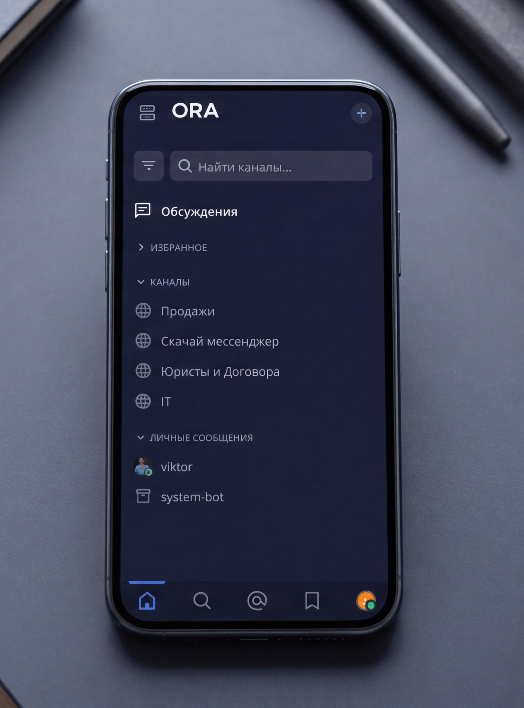

🌐 🇬🇧 English | **[Читать на русском](README.md)**

# 🚀 ORA Messenger — Ultimate Enterprise Communication & Business Management Platform

**ORA Messenger** is a high-performance, fully secure, on-premise software solution designed for corporate communication, team collaboration, and project coordination for businesses of any scale. 

Engineered as a completely independent, self-hosted alternative to vulnerable cloud-based services, ORA is deployed exclusively on your organization's private servers. This guarantees absolute data privacy and 100% control over your corporate intelligence.

---

### 🌟 Key Advantages of ORA

* 🔒 **Absolute Security & Privacy (On-Premise)**
  All chats, confidential files, databases, and access logs are stored strictly on your local servers. No third parties, external hosters, or cloud providers can ever access your data.
* 🎨 **Deep "Turnkey" White-Label Customization**
  We completely rebrand the interface to match your corporate identity. Custom colors, your logos, unique typography, branded splash screens, and tailored navigation structures — the messenger will look and feel like your own proprietary in-house IT development.
* ⚡ **Enterprise-Grade Performance**
  The architecture of ORA is optimized for extreme data loads. The platform easily handles tens of thousands of concurrent active users, delivering instant messaging and heavy file transfers without latency.
* 🛠️ **Flexible Integration Ecosystem**
  Effortlessly connect any internal corporate systems: CRM, ERP, project management tools, CI/CD pipelines, or deploy smart AI bots to automate routine workflows via a robust and well-documented API.

---

### 📸 Interface & Core Features

The platform offers an advanced system of public and private channels, direct messages, structured discussion threads, built-in voice/video calls, and integrated task-tracking workflows.

  

Additional Features:
* 📂 **Smart File Storage:** Advanced, high-speed filtering and search for documents, media, and images within all chats.
* 👥 **Granular Access Control:** Flexible role-based permission system for internal employees, guests, and external contractors.
* 📱 **Cross-Platform Availability:** Native-like applications optimized for Web, Windows, macOS, Linux and Android.

---

### 💼 Commercial On-Premise Solution for Your Business

ORA Messenger is delivered as a turnkey licensed software product. Our engineering team handles the entire deployment, migration, and ongoing maintenance cycle.

#### What is included in the deployment package:
1. Bare-metal server deployment and core software environment configuration.
2. Complete UI/UX visual customization tailored to your corporate brand book.
3. Secure data migration from your legacy corporate chats (if required).
4. Regular security patches and feature updates.
5. Dedicated 24/7 technical support and infrastructure monitoring.

---

### 📞 Contact Us & Request a Demo

Ready to test ORA Messenger or schedule a personal corporate presentation for your executives? Get in touch with our team today!

* 🌐 **Official Project Website:** www.asrobots.ru
* ✉️ **Sales & Enterprise Inquiries:** admin@asrobots.ru
* 💬 **Direct Link to Telegram:** @RAEeng

---

  ORA Messenger • Premium Enterprise IT Solution • 2026. All rights reserved.

